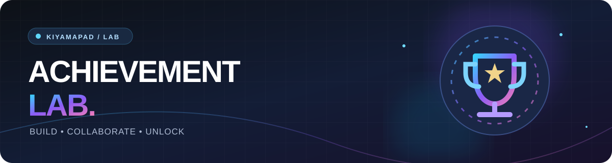

 

**All GitHub achievements. One open tracking space.**

[🏆 Complete guide](docs/ACHIEVEMENTS.md) · [🎯 Roadmap](docs/ROADMAP.md) · [🧪 How to earn them](docs/WORKFLOWS.md) · [👤 My profile](https://github.com/KiyamaPaD)

---

## 🏆 Achievement collection

**3 unlocked · 4 remaining.** YOLO was confirmed by the owner on **19 November 2026**. This tracker is manual, not connected to GitHub's award system.

### ✅ Unlocked

| Achievement | Condition | Status |
| :--- | :--- | :--- |
| 🦈 **Pull Shark** | Have 2 of your own pull requests merged | ✅ **Unlocked** |
| ⚡ **Quickdraw** | Close an issue or pull request within 5 minutes | ✅ **Unlocked** |
| 🚀 **YOLO** | Merge a pull request without a formal review | ✅ **Unlocked** — [PR #3](https://github.com/KiyamaPaD/Achievement-Lab/pull/3) / [PR #7](https://github.com/KiyamaPaD/Achievement-Lab/pull/7) |

### 🔒 Remaining

| Achievement | How to unlock | Can this lab help? | Status |
| :--- | :--- | :--- | :--- |
| 🤝 **Pair Extraordinaire** | Have a genuinely co-authored commit in a merged PR | ✅ With a real collaborator | ⬜ Not yet confirmed |
| 🧠 **Galaxy Brain** | Get 2 answers accepted in GitHub Discussions | 🌍 Requires real Q&A discussions | ⬜ Not yet confirmed |
| ⭐ **Starstruck** | Own a repo that reaches 16 stars | 🌍 Requires a public repository | ⬜ Not yet confirmed |
| 💜 **Public Sponsor** | Publicly sponsor an open-source maintainer through GitHub Sponsors | 💳 External, optional and paid | ⬜ Not yet confirmed |

> **Important:** Creating files, opening issues or ticking checkboxes does **not** award achievements. GitHub awards them for qualifying activity. Integration/bot actions may not be credited to the personal account.

## 🥇 Tier collection

Achievements with levels can be earned repeatedly to reach higher tiers. These thresholds are **community-documented**; only the official profile shows the tier actually awarded.

| Achievement | Default | Bronze | Silver | Gold | Current |
| :--- | ---: | ---: | ---: | ---: | :--- |
| 🦈 Pull Shark | 2 merged PRs | 16 | 128 | 1,024 | ✅ Base earned; higher levels unknown |
| 🤝 Pair Extraordinaire | 1 co-authored merged PR | 10 | 24 | 48 | ⬜ |
| 🧠 Galaxy Brain | 2 accepted answers | 8 | 16 | 32 | ⬜ |
| ⭐ Starstruck | 16 stars on your repo | 128 | 512 | 4,096 | ⬜ |

**Quickdraw**, **YOLO** and **Public Sponsor** do not have documented extra tiers.

## 🎮 Next actions

1. **Galaxy Brain 🧠 — next:** Help with authentic Q&A discussions on active repositories and earn **2 accepted answers**, confirmed by the discussion author or maintainer.
2. **Pair Extraordinaire 🤝 — in progress:** [Issue #4](https://github.com/KiyamaPaD/Achievement-Lab/issues/4) and [draft PR #5](https://github.com/KiyamaPaD/Achievement-Lab/pull/5) are ready. A real teammate must help write and verify changes, and a genuinely co-authored commit must be retained before merging.
3. **Starstruck ⭐:** Improve a **public** project such as [Mars Atlas](https://github.com/KiyamaPaD/InfotronX-Horizon), [MathHard](https://github.com/KiyamaPaD/MathHard), or [FTC Programming Atlas](https://github.com/KiyamaPaD/FTC-Programming-Atlas) and let stars arrive organically.
4. **Public Sponsor 💜:** Entirely optional; do **not** spend money merely for a badge.

Detailed steps are in **[Workflows →](docs/WORKFLOWS.md)**. Record proof and newly awarded tiers in **[Roadmap →](docs/ROADMAP.md)**.

## 🗂️ Other badges and archived achievements

**Historical (no longer obtainable):** Arctic Code Vault Contributor, Mars 2020 Contributor.

**Experimental/disabled (not active goals):** Heart On Your Sleeve, Open Sourcerer.

**Profile highlights (not Achievements):** PRO, Developer Program Member, Campus Expert, Security Advisory Credit, Security Bug Bounty Hunter. See the [full guide](docs/ACHIEVEMENTS.md) for distinctions.

GitHub Achievements are in public preview and may change. The list of currently available achievements was checked on **2026-11-16**. Sources: [GitHub Docs](https://docs.github.com/en/account-and-profile/reference/profile-reference) · [Community achievement catalog](https://github.com/SharmARohitt/Github-Achievement).

---

**Earn it for real. Track it here.** 🏆

Created for <a href="https://github.com/KiyamaPaD">KiyamaPaD</a> · Unofficial personal GitHub learning project

